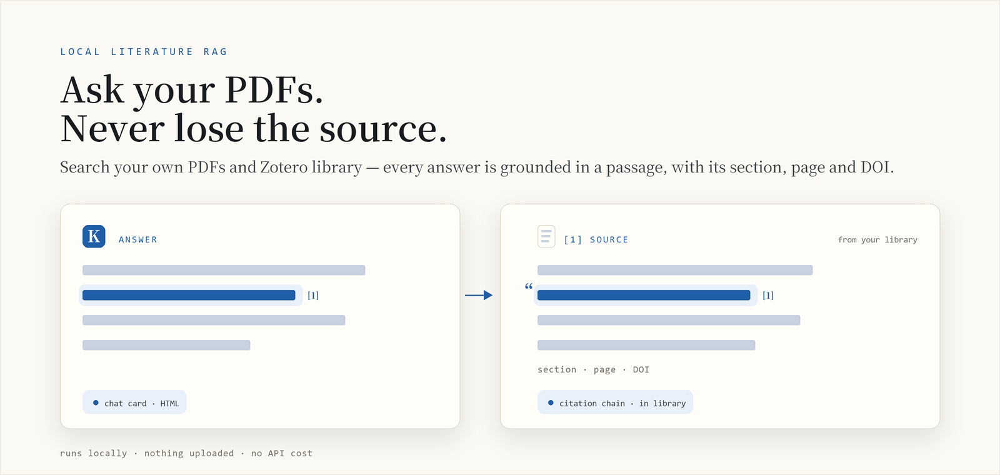
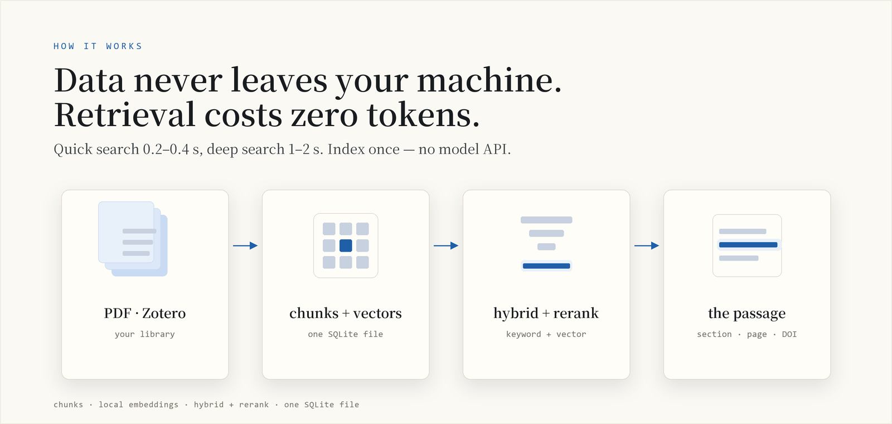
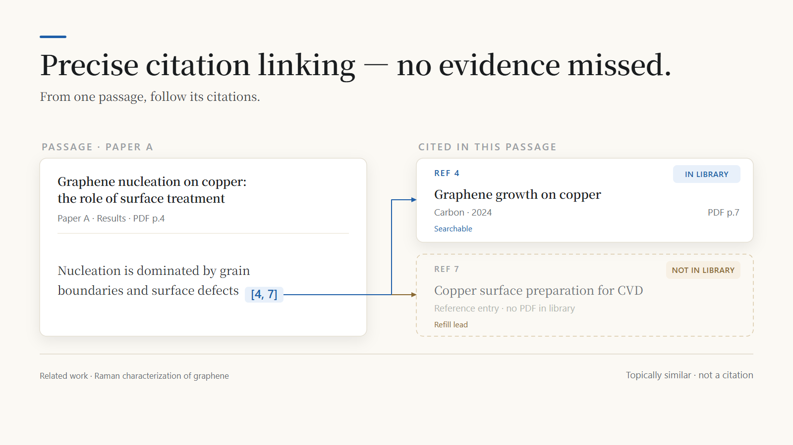
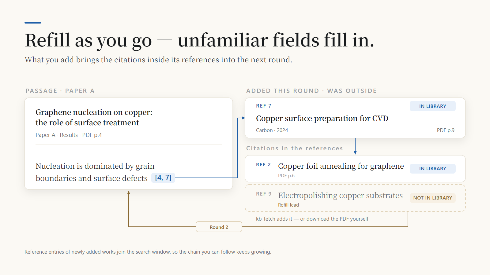
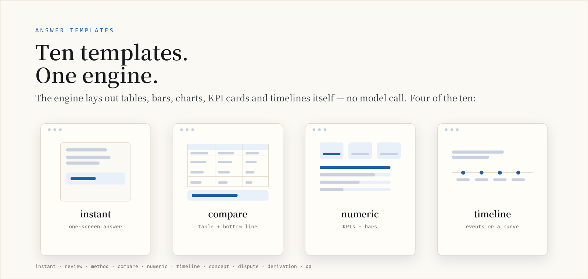
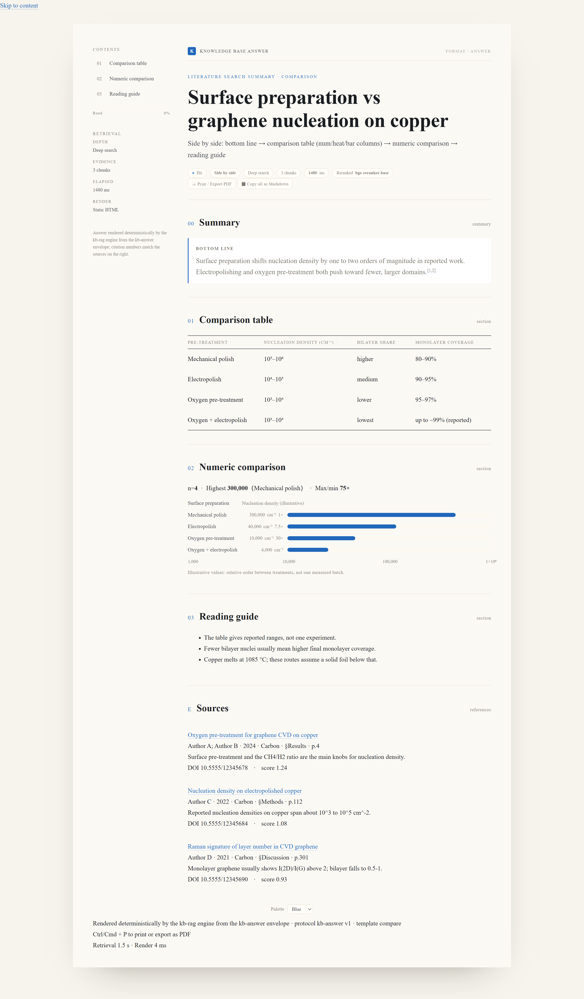

<p align="center">
  <picture>
    <source media="(prefers-color-scheme: dark)" srcset="docs/assets/brand/cover-en-dark.png">
    
  </picture>
</p>

# kb-rag: local literature RAG with passage-level provenance

[](https://www.npmjs.com/package/dsh-kb-rag)
[](https://www.npmjs.com/package/dsh-kb-rag)
[](https://github.com/Breeze136/dsh-kb-rag/releases)
[](LICENSE)
[](https://beancookie.github.io/awesome-dsh-plugin)
[](https://www.dsh.so/artifact/kb-rag/)

**English** | [Chinese](./README_CN.md)

kb-rag is a local literature knowledge base for DSH (DeepSeek Harness) and other MCP clients. It indexes PDFs and Zotero libraries into one SQLite file, then returns the passages that answer a question. Each result carries its section, physical page and DOI, and the citations attached to that passage, including whether the cited work is already in your library.

Indexing, embedding and reranking run on your machine. There is no API cost and nothing is uploaded. Warm queries take 0.33-0.38 s in `quick` mode and 1.4-1.9 s in `deep`; the first call after a restart can take up to 8.9 s while the models load.

The npm package [`dsh-kb-rag`](https://www.npmjs.com/package/dsh-kb-rag) is published from [`npm-package/`](./npm-package). One-page overview: [docs/promo.html](docs/promo.html). Forks and similarly named repositories are not release sources; the canonical repository is [Breeze136/dsh-kb-rag](https://github.com/Breeze136/dsh-kb-rag).

<p align="center">
  <picture>
    <source media="(prefers-color-scheme: dark)" srcset="docs/assets/brand/explainer-en-dark.png">
    
  </picture>
</p>
<p align="center"><sub><b>Figure 1</b>　Every answer line traces back to a passage in your library: section, page, DOI, and who that passage cites.</sub></p>

<p align="center">
  <picture>
    <source media="(prefers-color-scheme: dark)" srcset="docs/assets/brand/explainer-how-en-dark.png">
    
  </picture>
</p>
<p align="center"><sub><b>Figure 2</b>　All of it runs on your machine: chunking, embedding, keyword plus vector search, then a local rerank.</sub></p>

## What a result looks like

A `kb_rag` call returns evidence in this shape. The interface is in Chinese today, so the block below is a translation. `[in-library]` marks a cited work that is already indexed.

```text
**Knowledge base sources Top-2**
deep · reranked with BAAI/bge-reranker-base · cache hit

1. [Chemical vapour deposition of graphene on copper substrates](https://doi.org/10.5555/12345678) — Author A; Author B · 2024 · Carbon · Results · p.4
> graphene domains nucleate on the copper surface and coalesce into a continuous film ... at a growth rate of ~2 um/min
citations from this evidence ([in-library] = already held, searchable)
  · [Ref 4] Author C, et al. Carbon 48, 1234 (2010)
    [in-library] [Nucleation and growth of graphene on transition metals](https://doi.org/10.5555/12345684) (Author C · 2010 · Carbon) (this evidence's Ref 4) · [open in Zotero](zotero://open-pdf/library/items/EXAMPLEKEY1)
  · 3 further citations collapsed (Ref 6-8); use the numbers to fetch them

**Related work**
- [A Practical Guide to Raman Spectroscopy of Graphene] — Author G et al. · 2020 (same author, related topic)
```

Authors, journals and DOIs are placeholders; the format is real. The full walkthrough is in [`docs/OUTPUT-FORMAT.md`](docs/OUTPUT-FORMAT.md).

### Follow the citations

A passage keeps the citation marks printed in the PDF. kb-rag resolves each mark against the
library, so `[4, 7]` becomes two entries: one you already hold, with its own page number, and
one that is still outside — a lead to fetch rather than a dead end.

<p align="center">
  
</p>
<p align="center"><sub><b>Figure 3</b>　Solid arrows are citations the parser resolved; the line at the bottom is a related work, not a citation.</sub></p>

### Refilling is a loop

Add an outside reference — by DOI with `kb_fetch`, or by dropping the PDF into the folder and
ingesting again — and its own reference list enters the next search. The same question then
returns more evidence and a longer chain to follow. Indexing stays incremental: unchanged files
are skipped, nothing is rebuilt.

<p align="center">
  
</p>
<p align="center"><sub><b>Figure 4</b>　Ref 7 was outside the library; after refilling it opens at p.9, and its own Ref 9 becomes the next lead.</sub></p>

## What 1.6.8 changes

1.6.8 fixes two things that broke the DSH 0.2 install: the peer range and the client injection list. With both wrong, the plugin was rejected during install and the tool cards stayed empty.

The release also adds HTML answer pages rendered by the engine and a title-level probe. `kb_stats` now reports model cache state, and deep searches return `no_hit` when the best reranked score stays below the floor. The search core is otherwise unchanged: on the same library, results line up with 1.6.7. The full list is in [CHANGELOG.md](CHANGELOG.md).

## Install

kb-rag runs in the DSH desktop app. Install it from the plugin panel. The command-line routes exist for maintainers and old web deployments; new users do not need them.

### A. DSH desktop app

1. Open **Settings → Plugins** (设置 → 插件).
2. Search `kb-rag`. The package is `dsh-kb-rag`, and the entry should say **1.6.8**.
3. Install, restart DSH, and start a new conversation.

The desktop app needs to be 0.2 or newer. 1.6.7 and earlier fail that version's compatibility check; 1.6.8 is the first release that passes it.

#### Model download (the usual blocker)

The first search downloads the two models (~1.2 GB). This is the step most likely to stall. Let the plugin fetch them, or pre-download to a directory you choose:

```powershell
[Environment]::SetEnvironmentVariable("HF_HOME", "<cache-dir>", "User")
# new shell
$env:HF_HOME = "<cache-dir>"
python -c "from sentence_transformers import SentenceTransformer; SentenceTransformer('BAAI/bge-small-zh-v1.5')"
python -c "from sentence_transformers import CrossEncoder; CrossEncoder('BAAI/bge-reranker-base')"
```

Install `sentence-transformers` first if Python reports it missing. `kb_stats` reports whether both models are cached. If the default download stalls, set `HF_ENDPOINT=https://hf-mirror.com` and `KB_HF_MIRROR_FIRST=1`, restart DSH, and retry. Full notes: [docs/MIGRATION-1.6.8.md](docs/MIGRATION-1.6.8.md#模型预下载可选).

Already on 1.6.7? The plugin panel checks the installed 1.6.7 manifest, so installing 1.6.8 can fail with an error that quotes 1.6.7. Uninstall 1.6.7 first, then install 1.6.8.

### B. Coming from DSH web

The web profile is not a supported install target. Install the DSH desktop app, then follow A. The knowledge base (`.kb`) stays where it is; only the plugin host changes. Remove the old web-profile copy so the two do not drift:

```bash
dsh plugin --profile web remove dsh-kb-rag
```

### C. From source (maintainers)

```bash
git clone https://github.com/Breeze136/dsh-kb-rag.git && cd dsh-kb-rag
./npm-package/scripts/install.sh        # macOS / Linux / Git Bash
# Windows: install.cmd, or npm-package\scripts\install.ps1
```

If your desktop build cannot search npm, install [dsh-plugin-registry](https://github.com/beancookie/dsh-plugin-registry) once and use its marketplace panel. kb-rag is listed there.

> [!WARNING]
> Do not run `npm install dsh-kb-rag` inside a DSH profile. It writes an npm-style `node_modules` next to pnpm's symlink store, and later `dsh plugin` operations become unpredictable. `npm install` is only for a deployment you manage by hand; see [npm-package/README.md](npm-package/README.md).

### Troubleshooting

| Symptom | What it means | Fix |
|---|---|---|
| Panel quotes `@1.6.7 ... incompatible` | It checks the installed 1.6.7 manifest | Uninstall 1.6.7, restart, install 1.6.8 |
| `Cannot find package ...\dsh-kb-rag\index.js` | The GitHub repo root was installed, not npm | Uninstall it, install `dsh-kb-rag` from npm |
| `.hotload\...\package.json` missing | Stale local-preview metadata | Reinstall 1.6.8; clear the panel cache if it persists |
| Install worked, no `kb_*` tools | Old session, or the profile still has 1.6.7 | Restart DSH, open a new conversation, check the version |
| `/kb` missing in a brand-new session | The command list has not refreshed yet | Send one message, then type `/kb`; the tools work without it |
| Missing Python packages or models | Engine dependencies, not the plugin | Run the command in the error, or set `KB_AUTO_PIP=1`; models use `HF_ENDPOINT` |

Details and the before-report checklist: [docs/TROUBLESHOOTING.md](docs/TROUBLESHOOTING.md).

## User manual

### Build a library

Three ways in, depending on where the paper lives right now:

**Zotero library (do this first).** Preview before syncing, so a whole library does not move in by accident:

> Show me which Zotero items with PDF attachments can be ingested, without running it yet.

That is `kb_zotero(dry_run=true)`. Drop `dry_run` to run it; add `async_mode=true` for a whole-library migration. Zotero's title, authors, year, journal and DOI are written into the search results; items without a local PDF attachment are skipped, and nothing is downloaded for you. If auto-detection fails, pass the `zotero.sqlite` path explicitly.

**A folder of PDFs.**

> Add this graphene literature folder to the knowledge base and tell me how many files were added, skipped and failed.

Pass the folder path along; the agent calls `kb_ingest`, which handles PDF, TXT, MD and DOCX. Unchanged files are skipped by SHA-256; identical copies are recognised by hash and not indexed twice; a file is only re-parsed when its content changes.

**A single paper.** Give `kb_fetch` a DOI or arXiv ID and it downloads and indexes in one step:

> Use kb_fetch to fetch 10.5555/12345678, then ingest it.

Above `KB_ASYNC_THRESHOLD` (default 25) pending files, the batch forks into a background job and returns a `job_id` immediately. Poll it with `kb_status` until it reports `done`; a host-side timeout does not interrupt the job.

**Prefer PDFs that have a text layer.** A scanned PDF has none, so parsing fails with `no text extracted`; the engine does not OCR. Run such files through an OCR tool first, then ingest the result.

### Ask

- "Which papers discuss graphene growth on copper?" → `kb_search`
- "Which page states this?" → the `page` field on the evidence, or the Zotero page link
- "Answer only from the library" → strict mode through `kb_scope` (DSH)

Two retrieval modes, `quick` by default:

- **`quick` (default)** — find papers, look up terms, locate a passage fast. Hybrid recall, with no reranking, citation linking or related work.
- **`deep`** — compare methods across papers, build a review, follow a citation chain. Adds a reranker on top of hybrid recall, plus citation links and related work.

**Start with `quick`.** Its job is to confirm the library is built and returns grounded passages (0.2-0.4 s warm); once that checks out, switch to `deep` (1-2 s warm) for cross-paper comparison or citation chains. Switch in the conversation, set a session default with `/kb deep`, or pass `depth: "deep"` in MCP.

For a formatted answer, say "generate an HTML report": the agent passes an `answer` object and the engine writes a self-contained HTML page next to a gallery of earlier answers. Ten templates cover an instant one-screen card, a review, a method breakdown, a comparison, numeric findings, a timeline, a glossary, disputes, a derivation, and Q&A. See [HTML answers](#html-answers).

<p align="center">
  <picture>
    <source media="(prefers-color-scheme: dark)" srcset="docs/assets/brand/explainer-flow-en-dark.png">
    
  </picture>
</p>
<p align="center"><sub><b>Figure 5</b>　Three steps: build the library, ask in the chat, export a self-contained HTML answer. The index is built once.</sub></p>

<p align="center">
  <picture>
    <source media="(prefers-color-scheme: dark)" srcset="docs/assets/brand/explainer-templates-en-dark.png">
    
  </picture>
</p>
<p align="center"><sub><b>Figure 6</b>　Four of the ten answer templates: instant card, comparison, numeric KPIs, timeline.</sub></p>

### HTML answers

When a chat reply gets long and hard to scan, ask for an HTML report instead: in DSH, say "write this up as a shareable HTML report" and the agent passes an `answer` object to `kb_rag`. A plain `kb_rag` call returns evidence for the model to answer from and writes no file. The engine lays out the page itself: there is no model call, and rendering the sample pages takes 2-4 ms, separate from retrieval. The result's `answer_file` object carries `path`, `url`, `bytes`, `template`, `layout` and `warnings`.



*Rendered `compare` answer in English. The localized chrome is a preview of the next release; 1.6.8 ships Chinese chrome.* [Open the live page](https://breeze136.github.io/dsh-kb-rag/demo/answer-en.html)

```jsonc
{
  "query": "graphene CVD nucleation density on copper",
  "depth": "quick",
  "answer": {
    "template": "compare",                    // review is the default
    "fields": {
      "bottom_line": {
        "text": "Pre-treatment changes nucleation density by up to two orders of magnitude; oxygen plasma gives the lowest density and the highest monolayer coverage.",
        "refs": [1, 2]                        // 1-based indexes into this call's evidence
      },
      "matrix": {
        "columns": [
          { "label": "Pre-treatment" },
          { "label": "Density (cm⁻²)", "num": true },
          { "label": "Monolayer coverage", "num": true }
        ],
        "rows": [
          ["Mechanical polish", "10⁶–10⁷", "80–90%"],
          ["Electropolishing", "10⁶–10⁷", "90–95%"],
          ["Oxygen plasma", "10⁵–10⁶", "95–97%"]
        ]
      },
      "reading": ["Ranges come from different experiments; compare within a column, not across rows."]
    }
  }
}
```

**Templates.** The template fixes the sections, their order and each block's renderer; fields it does not define are ignored, and empty ones are skipped.

| `template` | Use it for | Main fields |
| --- | --- | --- |
| `instant` | one-screen answer to a single question | `answer`, `limit`, `followup` |
| `review` | synthesis across several papers | `bottom_line`, `state`, `methods`, `limits`, `takeaway` |
| `method` | one method end to end | `what`, `when`, `steps`, `params`, `figure`, `caveats` |
| `compare` | side-by-side comparison | `bottom_line`, `matrix`, `numbers`, `reading` |
| `numeric` | when the numbers are the point | `bottom_line`, `kpis`, `numbers`, `trend`, `reading` |
| `timeline` | how a line of work developed | `bottom_line`, `line` |
| `concept` | terms and definitions | `cards` |
| `dispute` | papers that disagree | `bottom_line`, `issues` |
| `derivation` | a derivation with a checkable result | `conventions`, `deriv`, `figure`, `result`, `code`, `verify`, `pitfalls` |
| `qa` | a concept explained in Q&A form | `intro`, `questions`, `summary` |

`stage: "instant"` is a shortcut: it selects `instant`, sets a 300-character budget, and forces `quick`. `layout: "doc"` switches from the card layout to long-form. `summary` supplies a one-line lead when the template has no `bottom_line`, or that field is empty.

**Fields.** A section takes a string, `{ text, refs }`, an array, a table (`{ columns: [{ label, num, heat, bar }], rows: [[...]] }` or a markdown pipe table), `{ items: [{ label, value, unit }] }` for `rank` and `kpis`, `{ x, series }` for `chart`, and `{ nodes, edges }` for `flow`. `refs` are 1-based indexes into this call's evidence; a number outside that range is reported in `warnings` and renders as a marker with no source. Write numbers and units as the paper gives them; the renderer derives axis ranges, ticks, bar lengths, heat levels and sort order, so do not pre-compute them. Fields are clipped at the template limit, and the whole envelope at `budget.max_total_chars` when set; every clip is listed in `warnings`.

**Files.** Pages land in `~/.kb-rag/answers/` as `<date>_<question-slug>-<hash8>.html`, next to `index.html` (a gallery of the latest 200 answers, newest first) and `index.json`. Set `answer_dir` on the call (an absolute path, or one starting with `~`), or `KB_ANSWER_DIR` in the environment, to move the folder. The filename carries a content hash, so re-rendering the same envelope on the same day overwrites one file instead of adding another.

**Open, print, share.** Open the file in any browser; it needs no server and no network. Formula pages are the one exception: they load MathJax from jsDelivr and fall back to raw TeX if that request fails. Two buttons at the top print or export to PDF and copy the body as Markdown; Ctrl/Cmd+P works too, and the layout holds down to phone width. The footer ends with the retrieval and render time for that answer:

```text
检索 1.6 s · 渲染 12 ms
```

Text-only clients still get the compact card; the HTML file is an addition, not a dependency.

**Colours.** Four presets (blue, green, ink, warm) are switchable from a control at the bottom and are remembered in that browser. To pin a default for the workspace, create `.kb-rag/answer-theme.json` next to `.kb`; a `theme` object on the call overrides it.

**Limits in 1.6.8.** The page chrome is Chinese; English chrome is planned for the next release. Unknown `template` names fall back to `review` in the engine; the DSH tool schema rejects them first.

| Symptom | Fix |
| --- | --- |
| Text answer only, no file | `answer` was not passed; ask for a report explicitly |
| `answer_file.ok` is false | the error text names the cause; fix it and re-run |
| A section is missing | its field was empty; empty sections are omitted |
| A field ends in `…` | the field hit its limit; `warnings` says which one |
| A citation marker has no source | its `refs` number is outside this call's evidence; `warnings` names it |
| Chinese labels in an English report | The chrome is Chinese; the body text is unchanged |

## Tools

The DSH plugin registers 10 tools.

| Tool | Purpose |
|---|---|
| `kb_ingest` | Ingest files or folders (PDF/TXT/MD/DOCX). Incremental skip, deduplication, section chunking, vectorisation. `metadata_only=true` refreshes title/authors/year/journal/DOI in place; `rebuild=true` re-parses every indexed document; large batches move to a background job |
| `kb_status` | Poll a background job: progress while `running`, totals and recent files when `done`, or the error |
| `kb_zotero` | Migrate a local Zotero library, including PDF attachments |
| `kb_search` | Hybrid retrieval returning passages with title, authors, year, journal, DOI, page and section |
| `kb_rag` | Evidence-based answering with numbered citations; optional HTML answer page |
| `kb_scope` | Query scope (library / library plus web / web), strict mode, retrieval depth |
| `kb_dedup` | Remove duplicate documents, keeping the earliest copy |
| `kb_clear` | Wipe all documents and indexes; requires `confirm=true` |
| `kb_stats` | Document, chunk and vector counts, recent ingests, model cache state, stale documents |
| `kb_fetch` | Download a PDF by DOI or arXiv ID (publisher version first, open-access fallback) |

The MCP server exposes 10 tools as well, including `kb_status` and a diagnostic `kb_mcp_status`. `kb_scope` is DSH-specific and has no MCP equivalent. MCP keeps `kb_rag`'s default at `deep`; the DSH plugin defaults to `quick`. Configuration and client snippets: [mcp-server/README.md](mcp-server/README.md).

### Engine capabilities

- Chunking is section-aware: abstracts get weight 1.5, methods 1.2. It also handles inline headings, abstract promotion, caption blocks and paragraph merging for non-article documents.
- Retrieval combines BM25 (with CJK bigrams), bge-small vector cosine, RRF fusion and section weights.
- Reranking uses bge-reranker-base to cut the top 20 down to 3, with a bge-large-en bi-encoder as fallback.
- Every passage carries its PDF page and section. The page renders as `section · p.N` and maps onto Zotero's `?page=N` link.
- In-text `[n]` markers resolve to reference entries. Nature-style superscripts are detected from font metrics, so `graphene1,2` becomes `graphene[1,2]`. Cited works are matched by DOI, normalised title, or first author plus year, and in-library matches are marked.
- SHA-256 hashes skip unchanged files (about 40× faster on re-runs) and catch duplicate copies across folders.
- Each document records the parser revision that wrote it (`docs.indexed_with`), so `kb_stats` can report rows an older revision left behind.
- Identical queries hit a cache. Any ingest or engine rebuild clears it.
- The engine runs as a resident daemon. Models load once, the daemon recovers from crashes, and it is released when the plugin stops.
- If the library's vectors were built with a different embedding model, retrieval stops with an explicit error instead of falling back to keyword search.

## Query guidance

Ask in whatever language you think in. The agent rewrites your question into an English term string before it reaches the engine — most libraries are around 98% English — and adds a query in your own words when you want documents in that language.

Two things are worth doing:

- **Ask one thing at a time**, naming the material, method and property together. That retrieves far better than "summarise this for me".
- **Say the limits out loud** — "only papers from 2020 on", "just this journal". The agent turns them into `filters` rather than stuffing them into the query.

The mechanics — why a CJK keyword query cannot match English body text, which fields `filters` supports, what `lang_note` means — are in [docs/DESIGN.md](docs/DESIGN.md), section 5.

## MCP

```bash
pip install -r mcp-server/requirements.txt
python mcp-server/server.py
```

Register it as a stdio server in Claude Desktop, Cherry Studio, Kimi, Cursor, DeepSeek or another MCP host. The server shares the same engine and the same `kb.sqlite`. By default it uses `~/.kb-rag` rather than the DSH workspace `.kb`, and every tool accepts `kb_root` to point elsewhere. See [mcp-server/README.md](mcp-server/README.md) for config snippets, capability quarantine and timeout behaviour.

## Architecture

```text
DSH model / MCP client (Claude, Cherry, Kimi, Cursor, ...)
   |  tool call: kb_ingest / kb_search / kb_rag / kb_stats ...
   v
plugin host (JS) or MCP server (server.py + engine_client.py)
   |  JSON lines over stdio, one request/response per line
   v
kb_engine.py -- resident `serve` daemon (models load once)
   |-- ingest:  sha256 skip -> PyMuPDF extraction -> section chunking -> bge-small encode
   |             (committed per file; above KB_ASYNC_THRESHOLD the batch is forked as a job
   |              under .kb-jobs/ and a job_id is returned for kb_status to poll)
   |-- search:  SQL prefilter -> BM25 + vector -> RRF fusion -> bge-reranker rerank
   |             -> top-N verbatim passages with DOI, page, section and score
   `-- storage: <kb_root>/kb.sqlite (docs, chunks, vecs, cache; schema v4,
                migrations gated by PRAGMA user_version)
```

## Measured performance

Windows, CPU inference unless noted. Query numbers come from a 248-document / 20,760-chunk library; ingest numbers from a 242-file / 1.8 GB run.

| Metric | Result |
|---|---|
| Query latency (warm) | `quick` 0.33-0.38 s; `deep` 1.4-1.9 s, median 1.6 s |
| Cold first call | up to 8.9 s while models load |
| Ingest throughput | 242 PDF/DOCX files (1.8 GB) in 85.9 s, about 355 ms per document |
| Incremental re-run | same directory in 2.17 s, a 40× speed-up |
| HTML answer render | 2-4 ms per page in the sample set; retrieval is timed separately |
| Full re-index (GPU) | 316 PDFs / 23.5k chunks / 20.1k vectors in 219 s on an 8 GB consumer GPU, zero errors |
| Embedding throughput | 164 chunks/s on GPU vs 37 chunks/s on CPU (~4.4×); flat from batch 32 to 256, so tokenisation is the limiting factor |

Methodology and design rationale: [`docs/DESIGN.md`](docs/DESIGN.md).

### Device handling (GPU / CPU)

Ingestion and search share one embedding model. A CUDA build of torch is used automatically (`KB_DEVICE=auto`, the default).

- The device is probed before the first model load with a tiny matmul. A driver can report a GPU and still fail at the first kernel, so the probe catches that early and falls back to CPU with a readable reason. `KB_GPU_PROBE=0` skips the probe.
- Device failures during a call degrade instead of aborting: the batch is halved, then cut to 4, then the model moves to CPU and the call finishes. The batch size that worked is remembered. Non-device errors are raised unchanged.
- `reload` resets the device verdict after a driver fix. `drop_models=true` reloads the models onto the GPU without restarting the host.
- Batch sizes follow the device and free VRAM. `KB_EMBED_BATCH` / `KB_RERANK_BATCH` override them, but raising them does not speed up small models.
- CPU-only is about 4× slower on the embedding step. PDF extraction, chunking and BM25 are CPU-bound either way.

`kb_stats` reports the outcome in `device`, including `gpu_disabled_reason` and `note` when a fallback happened.

## Configuration

| Variable | Default | Applies to | Description |
|---|---|---|---|
| `KB_EMBED_MODEL` | `BAAI/bge-small-zh-v1.5` | Engine | Embedding model, downloaded to the Hugging Face cache on first use |
| `KB_RERANK_MODEL` | `BAAI/bge-reranker-base` | Engine | Reranking model |
| `KB_DEVICE` | `auto` | Engine | `auto` uses a working CUDA device; `cpu` / `cuda` / `cuda:1` / `mps` force a choice. Device failures fall back to CPU |
| `KB_GPU_PROBE` | `1` | Engine | `0` skips the one-off "can this device compute?" probe |
| `KB_EMBED_BATCH` | GPU 128 / CPU 32 (tiered below 8 GB) | Engine | Embedding batch size for ingest and search |
| `KB_RERANK_BATCH` | GPU 64 / CPU 16 (tiered below 8 GB) | Engine | Reranking batch size |
| `KB_MODEL_RETRY_SECS` | `120` | Engine | How long a failed model load is remembered before retrying (`0` = every call, negative = never) |
| `HF_ENDPOINT` | none | Engine | `https://hf-mirror.com` on restricted networks |
| `KB_HF_MIRROR_FIRST` | off | Engine | `1` tries the mirror before the direct download |
| `KB_AUTO_PIP` | `0` | npm package | `1` installs missing Python dependencies at startup (fixed argv); by default only prints the command |
| `KB_RAG_ROOT` | DSH: workspace `.kb`; MCP: `~/.kb-rag` | MCP | Knowledge base directory; per-call override with `kb_root` |
| `KB_RAG_PYTHON` | current interpreter | MCP | Interpreter used for the engine |
| `KB_ASYNC_THRESHOLD` | `25` | Engine | Pending files above which `kb_ingest` forks a background job |
| `KB_SQLITE_WAL` | off | Engine | `1` enables SQLite WAL; the default is safer when `.kb` is synchronised |
| `UNPAYWALL_EMAIL` | built-in placeholder | Engine | Contact address for Unpaywall in `kb_fetch`; set your own |

A workspace file `.kb-rag/engine.env` (KEY=VALUE, one per line) is merged into the engine's environment at startup; explicit environment variables win. It is the practical way to pin a model or mirror per library without editing system settings.

## Repository layout

```text
kb-rag/
├─ kb_engine.py              Python engine: chunking, retrieval, reranking, serve daemon
├─ install.cmd               Windows entry point (runs scripts\install.ps1)
├─ scripts/                  Installer scripts (install.ps1, install.sh)
├─ plugin/                   DSH dynamic plugin (kbrag.plugin.json, host.js, client.js)
├─ npm-package/              npm package dsh-kb-rag (published contents, cordis.patch.yml)
├─ dsh-kb-rag-install/       Micro-package for the bare `npx dsh-kb-rag-install` command
├─ mcp-server/               MCP server (server.py, engine_client.py)
├─ docs/                     DESIGN.md, OUTPUT-FORMAT.md, MIGRATION.md, BACKLOG.md
├─ tests/                    Engine and client test suites
├─ tools/                    Internal maintenance scripts (not published)
└─ QUICKSTART.md, CHANGELOG.md, SECURITY.md, UNINSTALL.md, LICENSE
```

Runtime data: the DSH plugin writes to `.kb/kb.sqlite` in the session workspace; the MCP server defaults to `~/.kb-rag/kb.sqlite`. Background job files live in `<kb_root>/.kb-jobs/` and are removed when a job finishes.

## Known limitations

- Scanned PDFs are not supported. Documents without a text layer are skipped; OCR is out of scope.
- Page anchors are PDF-only. TXT, MD and DOCX files, and documents indexed before schema v3, fall back to section-level location until re-ingested with `force`.
- Citation linking requires a re-ingest. Superscript detection and reference splitting run at parse time.
- Metadata is only as good as the PDF. It is never 100% accurate; when it is missing, title and year are judged from the cover page, and existing Zotero metadata is preferred.
- Captions are searchable as text; content that exists only inside a figure is not.
- Keyword matching is in memory. Beyond a few hundred thousand chunks, FAISS HNSW or SQLite FTS5 would be the next step.
- Some publishers redirect automated PDF requests to a login page. `kb_fetch` reports the failure and leaves the manual path (download, then `kb_ingest`) as the fallback.

## Documentation

| Document | Contents |
|---|---|
| [QUICKSTART.md](QUICKSTART.md) | Five-minute setup |
| [docs/DESIGN.md](docs/DESIGN.md) | Storage model, chunking, retrieval pipeline, engine protocol |
| [docs/OUTPUT-FORMAT.md](docs/OUTPUT-FORMAT.md) | Output and citation conventions |
| [docs/MIGRATION.md](docs/MIGRATION.md) | Schema migration, v1 through v4 |
| [docs/UPGRADE-1.6.8.md](docs/UPGRADE-1.6.8.md) | Upgrading from 1.6.7 when the plugin panel quotes the installed version |
| [docs/MIGRATION-1.6.8.md](docs/MIGRATION-1.6.8.md) | Migration notes for existing users (Chinese) |
| [docs/TROUBLESHOOTING.md](docs/TROUBLESHOOTING.md) | Symptom-to-fix table and the before-report checklist |
| [docs/BACKLOG.md](docs/BACKLOG.md) | Known gaps and how to verify a change |
| [mcp-server/README.md](mcp-server/README.md) | MCP configuration, tool mapping, timeouts |
| [npm-package/README.md](npm-package/README.md) | npm installation and troubleshooting |
| [SECURITY.md](SECURITY.md) | Execution model and security boundaries |
| [UNINSTALL.md](UNINSTALL.md) | Removal, leaving PDFs and Zotero untouched |
| [CHANGELOG.md](CHANGELOG.md) | Release history |

## Contact

- Bugs and feature requests: [GitHub Issues](https://github.com/Breeze136/dsh-kb-rag/issues)
- Questions: [GitHub Discussions](https://github.com/Breeze136/dsh-kb-rag/discussions)
- Security: see [SECURITY.md](SECURITY.md)

## License

[MIT](LICENSE). The `BAAI/bge-*` models are downloaded at runtime and remain under their own licences.
