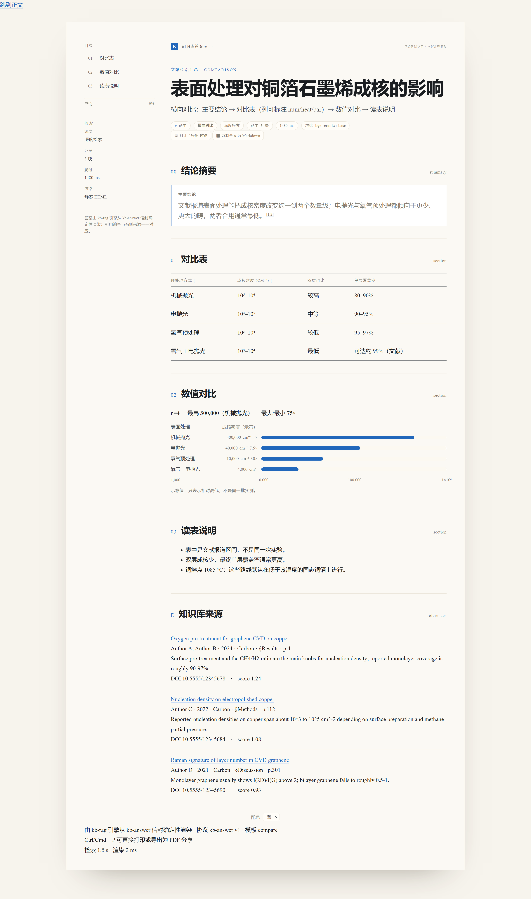

# kb-rag：本地文献 RAG，提供段落级溯源

[](https://www.npmjs.com/package/dsh-kb-rag)
[](https://www.npmjs.com/package/dsh-kb-rag)
[](https://github.com/Breeze136/dsh-kb-rag/releases)
[](LICENSE)
[](https://beancookie.github.io/awesome-dsh-plugin)
[](https://www.dsh.so/artifact/kb-rag/)

[English](./README.md) | **中文**

kb-rag 是给 DSH（DeepSeek Harness）和其他 MCP 客户端用的本地文献知识库。它把 PDF 与 Zotero 文库索引进一个 SQLite 文件，回答问题时返回原文段落，并带上章节、PDF 页码、DOI，以及这段证据附带的引用链。被引文献是否已在库内，也会标出来。

索引、向量化和重排都在本机完成，没有 API 费用，也不上传数据。

npm 包 [`dsh-kb-rag`](https://www.npmjs.com/package/dsh-kb-rag) 由本仓库的 [`npm-package/`](./npm-package) 发布；GitHub 上同名的其他仓库与本项目无关。

## 输出示例

一次 `kb_rag` 调用返回的证据如下。界面文案目前是中文，`[库内]` 表示该文献已在库内、可以直接检索：

```text
**知识库来源 Top-2**
深度检索（deep） · 精排 BAAI/bge-reranker-base · 缓存命中

1. [Chemical vapour deposition of graphene on copper substrates](https://doi.org/10.5555/12345678) — Author A; Author B · 2024 · Carbon · §Results · p.4
> graphene domains nucleate on the copper surface and coalesce into a continuous film ... at a growth rate of ~2 um/min
↳ 引文补充（本证据的参考文献；[库内]=已在库内，可检索引用）
  · [Ref 4] Author C, et al. Carbon 48, 1234 (2010)
    [库内] [Nucleation and growth of graphene on transition metals](https://doi.org/10.5555/12345684)（Author C · 2010 · Carbon）（即本证据的 Ref 4，可检索引用）· [Zotero 打开](zotero://open-pdf/library/items/EXAMPLEKEY1)
  ↳ 另有 3 条库外引文未展开（Ref 6–8），补库时可按编号定位

**关联文献（可作补充建议）**
- [A Practical Guide to Raman Spectroscopy of Graphene] — Author G et al. · 2020（同作者 · 主题相似）
```

作者、期刊与 DOI 都是占位数据，格式是真实输出。完整流程见 [`docs/OUTPUT-FORMAT.md`](docs/OUTPUT-FORMAT.md)。

## 1.6.8 改了什么

1.6.8 修的是 DSH 0.2 安装路径上的两个错误：peer 范围和客户端 inject 名单。两处都错，于是安装被兼容检查拒绝、工具卡片一直是空的。

这个版本还加了引擎渲染的 HTML 答案页和标题级探针。`kb_stats` 现在会报告模型缓存状态；深度检索最高分低于地板时返回 `no_hit`。检索内核没动：同一个库上，结果与 1.6.7 对得上。完整列表见 [CHANGELOG.md](CHANGELOG.md)。

## 安装

kb-rag 面向 DSH 桌面端，从插件面板安装。命令行路径只留给维护者和旧的 web 部署，新用户不需要。

### A. DSH 桌面端

1. 打开 **设置 → 插件**。
2. 搜索 `kb-rag`。包名是 `dsh-kb-rag`，条目版本应为 **1.6.8**。
3. 安装，重启 DSH，新建会话。

桌面端需要 0.2 及以上。1.6.7 及更早会被 0.2 的兼容检查拒绝；1.6.8 是第一个能通过的版本。首次检索要下载两个模型（约 1.2 GB）；`kb_stats` 能看到是否已就绪。

已经装了 1.6.7 的话：插件面板会拿已安装的 1.6.7 清单做兼容检查，装 1.6.8 时可能报 1.6.7 不兼容。先在面板卸载 1.6.7，再装 1.6.8。

### B. 从 DSH web 迁过来

web profile 不再是受支持的安装目标。装 DSH 桌面端，按 A 安装。知识库（`.kb`）留在原处，变的只是插件宿主。把 web profile 里的旧副本删掉，避免两边漂移：

```bash
dsh plugin --profile web remove dsh-kb-rag
```

### C. 从源码安装（维护者）

```bash
git clone https://github.com/Breeze136/dsh-kb-rag.git && cd dsh-kb-rag
./npm-package/scripts/install.sh        # macOS / Linux / Git Bash
# Windows：install.cmd，或 npm-package\scripts\install.ps1
```

Windows 上如果连 DSH 都还没装，可以用配套的 [dsh-oneclick](https://github.com/Breeze136/dsh-oneclick/releases/latest) 压缩包：它会装好 Node.js、DSH 命令行工具、桌面快捷方式，并可顺带装本插件、Python 依赖与模型。完整解压后双击 `install.cmd`。它是第三方辅助脚本，不是 DeepSeek 官方发布，只是把官方包按官方渠道装好。

如果桌面端内置插件页不能搜索 npm，先装 [dsh-plugin-registry](https://github.com/beancookie/dsh-plugin-registry)，用它的市场面板安装，kb-rag 在列表中。

> [!WARNING]
> 不要在 DSH profile 里执行 `npm install dsh-kb-rag`。它会在 pnpm 的符号链接存储旁写一份 npm 风格的 `node_modules`，之后 `dsh plugin` 的行为会变得不可预测。`npm install` 只适用于完全手工管理的部署，见 [npm-package/README.md](npm-package/README.md)。

## 排错

| 现象 | 实际含义 | 处理 |
|---|---|---|
| 面板报 `@1.6.7 ... 不兼容` | 它在检查已安装的 1.6.7 清单 | 卸载 1.6.7，重启，再装 1.6.8 |
| `Cannot find package ...\dsh-kb-rag\index.js` | 装成了 GitHub 仓库根，不是 npm 包 | 卸载它，从 npm 装 `dsh-kb-rag` |
| `.hotload\...\package.json` 不存在 | 旧本地预览留下的过期元数据 | 重装 1.6.8；还在就清面板缓存 |
| 装完没有 `kb_*` 工具 | 旧会话，或 profile 里还是 1.6.7 | 重启 DSH，新建会话，核对版本 |
| 缺 Python 包或模型 | 引擎依赖问题，不是插件本身 | 按报错里的命令装，或设 `KB_AUTO_PIP=1`；模型用 `HF_ENDPOINT` |

详细步骤和提问前要带的材料：[docs/TROUBLESHOOTING.md](docs/TROUBLESHOOTING.md)。

## 建库

在 DSH 会话里让 agent 入库一个文件夹（`kb_ingest`），或同步 Zotero（`kb_zotero`）。单篇论文可以先按 DOI / arXiv ID 取回（`kb_fetch`）：它先试出版商正式版，校园网或机构订阅可以直接下到，失败再回退开放获取。

待处理文件超过 `KB_ASYNC_THRESHOLD`（默认 25）时，`kb_ingest` 会把这一批 fork 成后台任务，立刻返回 `job_id`。用 `kb_status` 轮询到 `done`；宿主调用超时不会中断任务。整库 Zotero 迁移用 `kb_zotero(async_mode=true)`，行为一致。

## 提问

- “库里哪些论文讨论铜上石墨烯生长？” → `kb_search`
- “这是哪篇的哪一页？” → 看证据里的 `page` 字段，或点 Zotero 页码链接
- “只依据库内文献回答” → 用 `kb_scope` 开严格模式（DSH）
- “快速看一眼还是深入分析？” → 两个工具默认 `quick`；传 `depth: "deep"` 开重排、引用关联与相关文献，或用 `/kb deep` 设会话默认

需要一份能发出去的成品时，给 `kb_rag` 传 `answer` 对象，引擎会写一份自包含 HTML 答案页，并在同目录维护历史答案画廊。十种模板覆盖一屏直答、综述、方法拆解、横向对比、数值发现、时间线、术语卡、争议清单、推导与问答。见 [HTML 答案页](#html-答案页)。

## 工具

DSH 插件注册 10 个工具。

| 工具 | 用途 |
|---|---|
| `kb_ingest` | 入库文件或文件夹（PDF/TXT/MD/DOCX）。增量跳过、去重、按章节切分、向量化。`metadata_only=true` 原地刷新标题/作者/年份/期刊/DOI；`rebuild=true` 重新解析库内全部文档；大批量自动转后台 |
| `kb_status` | 按 `job_id` 轮询后台任务：`running` 给进度，`done` 给 totals 与最近文件，失败时给原因 |
| `kb_zotero` | 迁移本地 Zotero 文库，含 PDF 附件 |
| `kb_search` | 混合检索，返回带标题、作者、年份、期刊、DOI、页码与章节的原文段落 |
| `kb_rag` | 证据式问答，带编号引用；可选生成 HTML 答案页 |
| `kb_scope` | 查询范围（仅库 / 库加全网 / 仅全网）、严格模式、检索深度 |
| `kb_dedup` | 删除重复文档，保留最早的一份 |
| `kb_clear` | 清空全部文档与索引；需要 `confirm=true` |
| `kb_stats` | 文档、分块、向量数量，最近入库，模型缓存状态，陈旧文档 |
| `kb_fetch` | 按 DOI 或 arXiv ID 下载 PDF（先试出版商正式版，再回退开放获取） |

MCP 服务器同样暴露 10 个工具，包括 `kb_status` 与诊断用的 `kb_mcp_status`。`kb_scope` 是 DSH 专有，MCP 没有对应工具。MCP 的 `kb_rag` 默认 `deep`，DSH 插件默认 `quick`。配置与客户端片段见 [mcp-server/README.md](mcp-server/README.md)。

### 引擎能力

- 切分按章节走：摘要权重 1.5，方法 1.2；支持行内标题识别、摘要提升、图注块，非论文类文档会做段落合并。
- 检索是 BM25（支持中日韩二元组）+ bge-small 向量余弦 + RRF 融合 + 章节加权。
- 重排用 bge-reranker-base 把 top 20 收到 top 3，交叉编码器不可用时回退 bge-large-en 双编码器。
- 每条结果带 PDF 页码和章节，页码渲染成 `section · p.N`，对应 Zotero 的 `?page=N` 链接。
- 文内 `[n]` 解析到参考文献条目；Nature 风格上标按字体度量识别，`graphene1,2` 会变成 `graphene[1,2]`。被引文献按 DOI、规范化标题或第一作者加年份匹配，库内命中会标出来。
- SHA-256 哈希跳过未变文件（重跑约快 40 倍），并拦截跨路径的重复副本。
- 每篇文档记录写入它时的解析器版本（`docs.indexed_with`），`kb_stats` 能报告旧版本留下的行。
- 相同查询命中缓存；入库或引擎重建会让缓存失效。
- 引擎是常驻守护进程，模型只加载一次，崩溃后能恢复，插件停止时释放。
- 库内向量与当前嵌入模型不匹配时，检索直接报错，不会静默退成关键词。

## 检索建议

查询按原样送进引擎，不翻译、不扩写、不改写。所以查询语言要和库内正文一致。多数文库约 98% 是英文，实际会碰到几条规则。

DSH 会话里查询由 agent 写。它的工具描述已经会把中文问题转成英文术语串，直接用中文提问是正常的。只有自己直接驱动工具时（MCP 客户端、脚本、引擎 CLI），才需要手写英文术语串。

BM25 按词元匹配。中文查询匹配不上英文正文，混合检索的关键词路等于空转，命中只能靠向量相似度。同一个问题，英文术语串的召回明显更好。

查询控制在 3-12 个词，结构是 `材料/体系 + 方法/工艺 + 性质/表征`，例如 `graphene CVD copper single crystal nucleation suppression`，不要写整句。

限定条件放 `filters`，不要写进查询。年份、期刊、作者、章节、文件类型都是元数据过滤。`journal` 只由 Zotero 迁移填充，用 `kb_ingest` 入库的文档该字段是 `NULL`，用它过滤通常零命中。改用作者、年份、标题或章节。

只有确实想要中文文献时，才用原话另发一条中文查询，例如库内还存了中文综述。

当查询含中日韩字符而库内几乎全英文时，响应会带 `lang_note`，插件会把它渲染在结果旁。

## HTML 答案页

`kb_rag` 接受一个 `answer` 对象，返回一份自包含 HTML 和一张紧凑的文本卡片。页面由引擎自己排版：不调用模型，文件也不发外部请求。



*`compare` 模板的实际渲染结果，页脚带检索与渲染耗时。*

[打开可交互页面](https://breeze136.github.io/dsh-kb-rag/demo/answer-zh.html) · [HTML 源码](docs/demo/answer-zh.html)

```jsonc
{ "query": "graphene CVD nucleation density", "depth": "quick",
  "answer": { "stage": "instant",                       // 一屏直答，300 字符预算
              "template": "compare",                    // review | method | compare | numeric | timeline | concept | dispute | derivation | qa
              "fields": { "bottom_line": { "text": "…", "refs": [1] },
                          "matrix": { "columns": [{ "label": "Pre-treatment" }, { "label": "Density", "num": true }],
                                      "rows": [["Mechanical polish", "10⁶–10⁷"]] } } } }
```

`refs` 是本次 `evidence` 的 1 基下标，越界的会在渲染前被拒绝。每个字段受模板上限约束，整封受 `budget.max_total_chars` 约束。图由你给的数字算出来：轴范围、刻度、条长、热力档位都由渲染器决定，不要自己先算。

页面有四套配色（blue、green、ink、warm），可在页底切换，也可以在工作区 `.kb-rag/answer-theme.json` 里固定。页脚最后一行是这份答案的检索与渲染耗时：

```text
检索 1.6 s · 渲染 12 ms
```

文件落在 `~/.kb-rag/answers/`（可用 `KB_ANSWER_DIR` 或 `answer_dir` 改），同目录有 `index.html` 画廊。纯文本客户端仍然拿到卡片；HTML 是附加产物，不是依赖。

## MCP

```bash
pip install -r mcp-server/requirements.txt
python mcp-server/server.py
```

把它注册成 stdio server，可用 Claude Desktop、Cherry Studio、Kimi、Cursor、DeepSeek 等宿主。服务器共用同一个引擎与同一份 `kb.sqlite`。默认库在 `~/.kb-rag`，不是 DSH 工作区的 `.kb`，每个工具都可以用 `kb_root` 指到别处。配置片段、能力隔离与超时行为见 [mcp-server/README.md](mcp-server/README.md)。

## 架构

```text
DSH model / MCP client (Claude, Cherry, Kimi, Cursor, ...)
   |  tool call: kb_ingest / kb_search / kb_rag / kb_stats ...
   v
plugin host (JS) or MCP server (server.py + engine_client.py)
   |  JSON lines over stdio, one request/response per line
   v
kb_engine.py -- resident `serve` daemon (models load once)
   |-- ingest:  sha256 skip -> PyMuPDF extraction -> section chunking -> bge-small encode
   |             (committed per file; above KB_ASYNC_THRESHOLD the batch is forked as a job
   |              under .kb-jobs/ and a job_id is returned for kb_status to poll)
   |-- search:  SQL prefilter -> BM25 + vector -> RRF fusion -> bge-reranker rerank
   |             -> top-N verbatim passages with DOI, page, section and score
   `-- storage: <kb_root>/kb.sqlite (docs, chunks, vecs, cache; schema v4,
                migrations gated by PRAGMA user_version)
```

## 实测性能

Windows，除注明外均为 CPU 推理。查询数字来自 248 篇 / 20,760 块的文库；入库数字来自 242 个文件 / 1.8 GB 的一轮。

| 指标 | 结果 |
|---|---|
| 暖态查询延迟 | `quick` 0.33-0.38 s；`deep` 1.4-1.9 s，中位 1.6 s |
| 冷启动首调 | 最高 8.9 s（加载模型） |
| 入库吞吐 | 242 个 PDF/DOCX（1.8 GB）85.9 s，约 355 ms/篇 |
| 增量重跑 | 同一目录 2.17 s，约 40 倍加速 |
| 全量重灌（GPU） | 316 篇 / 2.35 万块 / 2.01 万向量，219 s，8 GB 消费级显卡，0 错误 |
| 嵌入吞吐 | GPU 164 块/s，CPU 37 块/s（约 4.4×）；批大小 32-256 持平，瓶颈在分词 |

测量方法与设计依据见 [`docs/DESIGN.md`](docs/DESIGN.md)。

### 设备处理（GPU / CPU）

入库与检索共用一个嵌入模型。装了 CUDA 版 torch 就自动用 GPU（`KB_DEVICE=auto`，默认）。

- 首次加载模型前会用一个小矩阵乘探测设备。驱动报告有卡不等于能算；版本不匹配、容器、独占计算模式都会在第一个内核上失败。探测会提前发现并带原因退回 CPU。`KB_GPU_PROBE=0` 可跳过。
- 调用中的设备故障是降级：批大小折半，再缩到 4，最后把模型移到 CPU，这次调用仍然跑完。跑通的批大小会被记住。非设备故障原样上抛。
- 修好驱动后用 `reload` 重置设备判定；`drop_models=true` 会把模型重新加载到 GPU，不必重启宿主。
- 批大小跟着设备与可用显存走。`KB_EMBED_BATCH` / `KB_RERANK_BATCH` 可覆盖，但小模型加大批没有收益。
- 纯 CPU 的嵌入约慢 4 倍。PDF 抽取、分块与 BM25 无论有没有 GPU 都是 CPU 密集。

结果写在 `kb_stats` 的 `device` 里，发生回退时还会带 `gpu_disabled_reason` 与 `note`。

## 配置

| 变量 | 默认值 | 适用对象 | 说明 |
|---|---|---|---|
| `KB_EMBED_MODEL` | `BAAI/bge-small-zh-v1.5` | 引擎 | 嵌入模型；首次使用时下载到 Hugging Face 缓存 |
| `KB_RERANK_MODEL` | `BAAI/bge-reranker-base` | 引擎 | 精排模型 |
| `KB_DEVICE` | `auto` | 引擎 | `auto` 用可用的 CUDA 设备；`cpu` / `cuda` / `cuda:1` / `mps` 强制指定。设备故障自动退回 CPU |
| `KB_GPU_PROBE` | `1` | 引擎 | `0` 跳过一次性设备探测 |
| `KB_EMBED_BATCH` | GPU 128 / CPU 32（显存 <8 GB 分档） | 引擎 | 入库与检索的嵌入批大小 |
| `KB_RERANK_BATCH` | GPU 64 / CPU 16（显存 <8 GB 分档） | 引擎 | 精排批大小 |
| `KB_MODEL_RETRY_SECS` | `120` | 引擎 | 模型加载失败后多久允许重试（`0` = 每次，负数 = 不重试） |
| `HF_ENDPOINT` | 无 | 引擎 | 受限网络下设为 `https://hf-mirror.com` |
| `KB_HF_MIRROR_FIRST` | 关闭 | 引擎 | `1` 时先试镜像，再试直连 |
| `KB_AUTO_PIP` | `0` | npm 包 | `1` 时在启动阶段安装缺失的 Python 依赖（固定 argv）；默认只打印命令 |
| `KB_RAG_ROOT` | DSH：工作区 `.kb`；MCP：`~/.kb-rag` | MCP | 知识库目录；可用 `kb_root` 按次覆盖 |
| `KB_RAG_PYTHON` | 当前解释器 | MCP | 引擎使用的解释器 |
| `KB_ASYNC_THRESHOLD` | `25` | 引擎 | 超过该待处理数时转后台任务 |
| `KB_SQLITE_WAL` | 关闭 | 引擎 | `1` 启用 SQLite WAL；`.kb` 会被同步时默认值更安全 |
| `UNPAYWALL_EMAIL` | 内置占位值 | 引擎 | `kb_fetch` 查询 Unpaywall 的联系邮箱；建议填自己的 |

工作区文件 `.kb-rag/engine.env`（每行 `KEY=VALUE`）会在引擎启动时并入环境，显式环境变量优先。按库固定模型或镜像时用它，不必改系统设置。

## 仓库结构

```text
kb-rag/
├─ kb_engine.py              Python engine: chunking, retrieval, reranking, serve daemon
├─ install.cmd               Windows entry point (runs scripts\install.ps1)
├─ scripts/                  Installer scripts (install.ps1, install.sh)
├─ plugin/                   DSH dynamic plugin (kbrag.plugin.json, host.js, client.js)
├─ npm-package/              npm package dsh-kb-rag (published contents, cordis.patch.yml)
├─ dsh-kb-rag-install/       Micro-package for the bare `npx dsh-kb-rag-install` command
├─ mcp-server/               MCP server (server.py, engine_client.py)
├─ docs/                     DESIGN.md, OUTPUT-FORMAT.md, MIGRATION.md, BACKLOG.md
├─ tests/                    Engine and client test suites
├─ tools/                    Internal maintenance scripts (not published)
└─ QUICKSTART.md, CHANGELOG.md, SECURITY.md, UNINSTALL.md, LICENSE
```

运行时数据：DSH 插件写会话工作区的 `.kb/kb.sqlite`；MCP 服务器默认 `~/.kb-rag/kb.sqlite`。后台任务文件在 `<kb_root>/.kb-jobs/`，任务结束即删除。

## 已知限制

- 不支持扫描版 PDF。没有文本层的文档会被跳过，OCR 不在范围内。
- 页码锚点只适用于 PDF。TXT、MD、DOCX 与 schema v3 之前入库的文档只能定位到章节，除非用 `force` 重新入库。
- 引用关联需要重新入库。上标识别与参考文献切分在解析阶段完成。
- 元数据可能读错。PDF 元数据缺失时标题与年份从页面文本推断；Zotero 元数据会覆盖。
- 引擎层的跨语言检索较弱。引擎不翻译，中文查询检索英文正文主要靠向量路，响应会带 `lang_note`。agent 层会把问题改写成英文术语串来补这一点。
- 图注只能当文本检索；只存在于图里的内容检索不到。
- 关键词匹配是内存实现。超过几十万块之后，FAISS HNSW 或 SQLite FTS5 是更合适的下一步。
- 部分出版商会把自动 PDF 请求重定向到登录页。`kb_fetch` 会如实报失败，保留手动下载再 `kb_ingest` 的路径。

## 文档

| 文档 | 内容 |
|---|---|
| [QUICKSTART.md](QUICKSTART.md) | 五分钟上手 |
| [docs/DESIGN.md](docs/DESIGN.md) | 存储模型、切分、检索流水线、引擎协议 |
| [docs/OUTPUT-FORMAT.md](docs/OUTPUT-FORMAT.md) | 输出与引用规范 |
| [docs/MIGRATION.md](docs/MIGRATION.md) | Schema 迁移，v1 到 v4 |
| [docs/UPGRADE-1.6.8.md](docs/UPGRADE-1.6.8.md) | 从 1.6.7 升级时面板误报已安装版本的排查 |
| [docs/MIGRATION-1.6.8.md](docs/MIGRATION-1.6.8.md) | 老用户迁移：桌面端升级、web 转桌面、数据与验证 |
| [docs/TROUBLESHOOTING.md](docs/TROUBLESHOOTING.md) | 按现象查处理，以及提问前要带的材料 |
| [docs/BACKLOG.md](docs/BACKLOG.md) | 已知缺口与回归验证方法 |
| [mcp-server/README.md](mcp-server/README.md) | MCP 配置、工具映射、超时 |
| [npm-package/README.md](npm-package/README.md) | npm 安装与故障排查 |
| [SECURITY.md](SECURITY.md) | 执行模型与安全边界 |
| [UNINSTALL.md](UNINSTALL.md) | 卸载，不影响 PDF 与 Zotero |
| [CHANGELOG.md](CHANGELOG.md) | 版本历史 |

## 联系

- 缺陷与功能请求：[GitHub Issues](https://github.com/Breeze136/dsh-kb-rag/issues)
- 疑问与讨论：[GitHub Discussions](https://github.com/Breeze136/dsh-kb-rag/discussions)
- 安全问题：见 [SECURITY.md](SECURITY.md)

## 许可

[MIT](LICENSE)。`BAAI/bge-*` 模型在运行时下载，遵循各自的许可协议。
