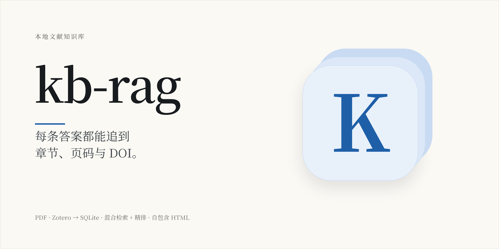
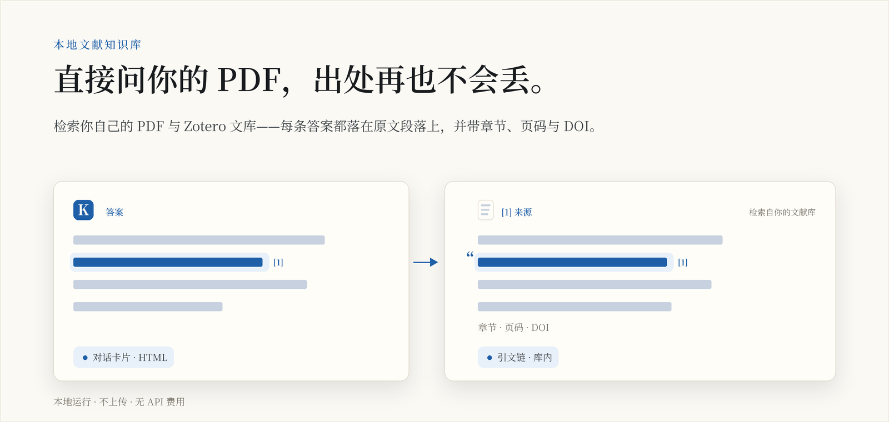
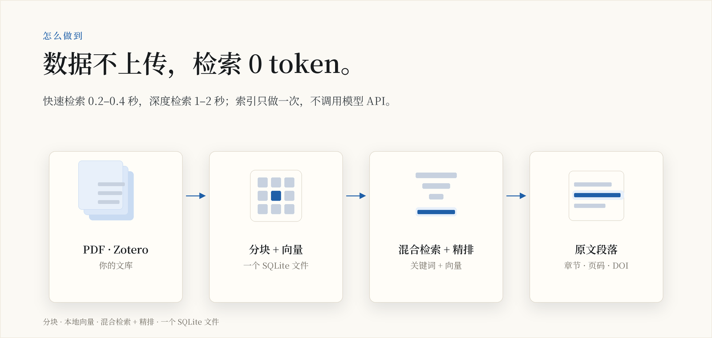
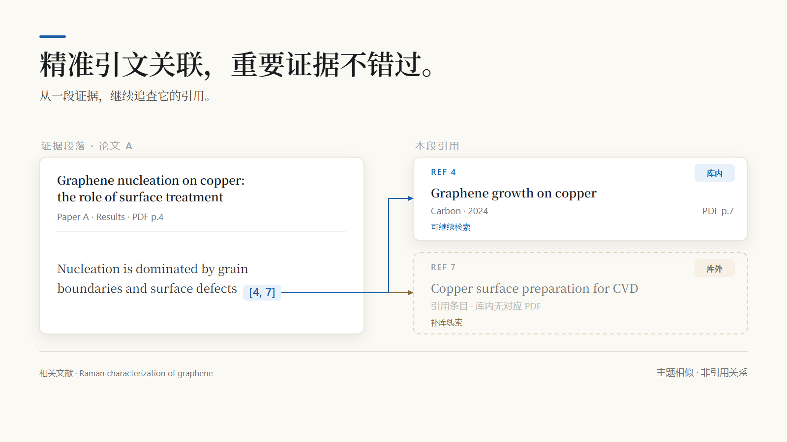
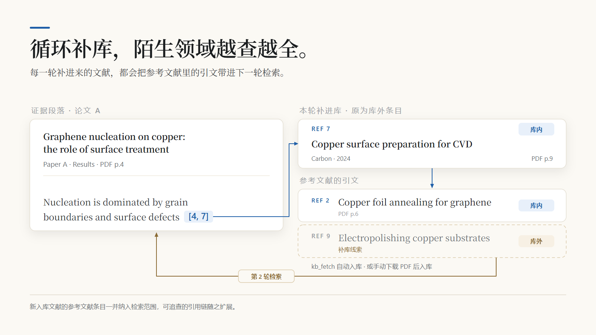
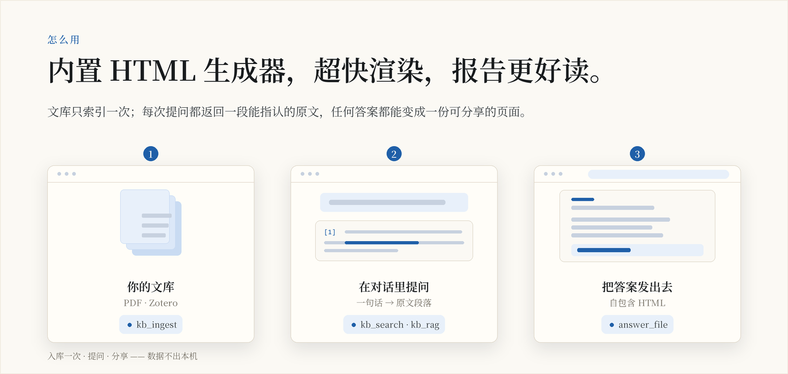
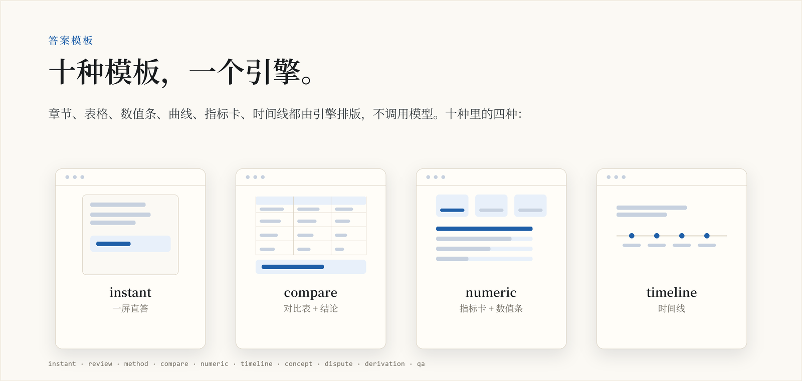

<p align="center">
  <picture>
    <source media="(prefers-color-scheme: dark)" srcset="docs/assets/brand/cover-zh-dark.png">
    
  </picture>
</p>

# kb-rag：本地文献 RAG，答案带章节、页码与 DOI

[](https://www.npmjs.com/package/dsh-kb-rag)
[](https://www.npmjs.com/package/dsh-kb-rag)
[](https://github.com/Breeze136/dsh-kb-rag/releases)
[](LICENSE)
[](https://beancookie.github.io/awesome-dsh-plugin)
[](https://www.dsh.so/artifact/kb-rag/)

[English](./README.md) | **中文**

读过的论文散在几个文件夹和 Zotero 里，回头找某句结论只能凭记忆。kb-rag 把这些 PDF 建成本地索引：提问时返回原文段落，同时给出这段所在的文献、章节、PDF 页码和 DOI。

解析、嵌入和重排都在本机完成，没有嵌入或重排 API 的费用，文库也不上传。暖态查询 `quick` 约 0.33–0.38 秒，`deep` 约 1.4–1.9 秒；重启后的首次调用要加载模型，最高约 8.9 秒。

npm 包 [`dsh-kb-rag`](https://www.npmjs.com/package/dsh-kb-rag) 由本仓库的 [`npm-package/`](./npm-package) 发布。同名 fork 和名称相近的仓库都不是发布源，以 [Breeze136/dsh-kb-rag](https://github.com/Breeze136/dsh-kb-rag) 为准。

<p align="center">
  <picture>
    <source media="(prefers-color-scheme: dark)" srcset="docs/assets/brand/explainer-zh-dark.png">
    
  </picture>
</p>
<p align="center"><sub><b>图 1</b>　答案的每一句都能回到库里的一段原文：章节、页码、DOI，以及这段引用了谁。</sub></p>

<p align="center">
  <picture>
    <source media="(prefers-color-scheme: dark)" srcset="docs/assets/brand/explainer-how-zh-dark.png">
    
  </picture>
</p>
<p align="center"><sub><b>图 2</b>　怎么做到：分块与向量化都在本机，一个 SQLite 文件同时承载关键词索引与向量索引。</sub></p>

## 适合谁，不适合谁

| 你的情况 | 结论 |
|---|---|
| 攒了一批 PDF 或 Zotero 文库，经常要找“那句话在哪一篇、哪一页” | 适合 |
| 结论必须能落到章节和 PDF 页码，能点开原文核对 | 适合 |
| 想弄清一段话引用了谁，哪些已在库内、哪些还缺 | 适合 |
| 愿意边用边补库，让同一个问题越查越全 | 适合 |
| 主要是扫描件，想检索图片里的图表和数值 | 不适合：不做 OCR，图内信息检索不到 |
| 只想要一个全文关键词搜索框 | 不适合：返回的是带出处的证据段落，不是全文检索界面 |
| 需要云端文库、多人协作 | 不适合：单机索引，就是本机的一个 SQLite 文件 |

## 一次检索返回什么

假设你问：

> 库里哪些论文讨论了铜表面对石墨烯成核的影响？给出章节、页码和出处。

深度检索的返回大致是这样（真实输出里长条目是一行，这里折开写）：

```text
**知识库来源 Top-2**
深度检索（deep） · 精排 BAAI/bge-reranker-base · 缓存命中

1. Graphene nucleation on copper: the role of surface treatment
   Author A; Author B · 2024 · Carbon · §Results · p.4
   DOI: 10.5555/12345678
> nucleation is dominated by grain boundaries and surface defects [4, 7].
↳ 引文补充（[库内] = 已在库内，可检索引用）
  · [Ref 4] Graphene growth on copper
    [库内] Author C · 2023 · Carbon · PDF p.7 · 可继续检索
  · [Ref 7] Copper surface preparation for CVD
    [库外] 库内没有对应 PDF，可作补库线索

**关联文献（可作补充建议）**
- Raman characterization of graphene（同作者 · 主题相似）
```

标题、作者、年份、DOI 都是占位数据。结果里有三种关系：

| 标记 | 含义 | 下一步 |
|---|---|---|
| 证据来源 | 本次检索命中的原文段落所在文献 | 打开原文，看上下文 |
| 段落引用 | 从这段正文的引用标记关联到的参考文献 | 看库内状态，继续检索或补库 |
| 相关文献 | 按作者、期刊或主题推荐，与这段正文没有引用关系 | 作为扩展阅读线索 |

`[库内]` 只表示在当前知识库里匹配到了这篇被引文献，不代表已经读过它的全文。

<p align="center">
  
</p>
<p align="center"><sub><b>图 3</b>　实线是已解析出的引用关系；底部那条相关文献只表示主题相似，与该段落没有引用关系。</sub></p>

## 补库是循环，不是建库时的一次性动作

把库外条目补进库之后，这篇文献自己的参考文献会进入下一次检索，新的库外条目随之出现。同一个问题再问一遍，命中的证据和能追下去的引用链都比上一轮更完整。

<p align="center">
  
</p>
<p align="center"><sub><b>图 4</b>　演示数据：Ref 7 入库前是库外条目，入库后可打开到 PDF p.9；它自己的参考文献里的 Ref 9 是下一轮的待补条目。</sub></p>

## 生成一份带来源的 HTML 报告

<p align="center">
  <picture>
    <source media="(prefers-color-scheme: dark)" srcset="docs/assets/brand/explainer-flow-zh-dark.png">
    
  </picture>
</p>
<p align="center"><sub><b>图 5</b>　三步：建库 → 提问 → 导出。导出的是自包含 HTML 报告，索引只做一次。</sub></p>

在 DSH 里直接说：

> 用深度检索，对比库内文献中的铜基底预处理方法，生成一份带来源的 HTML 报告。不同文献的条件差异单独说明。

agent 会给 `kb_rag` 传一个 `answer` 对象，引擎按模板排版并写出 HTML 文件；普通检索不传 `answer` 时不会生成任何文件。模板决定有哪些小节、顺序和每块的渲染器：

| 类型 | 模板 | 适合的内容 |
|---|---|---|
| 直答与综述 | `instant`、`review` | 单点回答、专题整理 |
| 方法与比较 | `method`、`compare` | 步骤、参数、横向对照 |
| 数字与发展 | `numeric`、`timeline` | 数值摘要、时间线 |
| 概念与分歧 | `concept`、`dispute` | 术语卡、文献争议 |
| 推导与问答 | `derivation`、`qa` | 推导过程、解释性问答 |

<p align="center">
  <picture>
    <source media="(prefers-color-scheme: dark)" srcset="docs/assets/brand/explainer-templates-zh-dark.png">
    
  </picture>
</p>
<p align="center"><sub><b>图 6</b>　十种模板里的四种：直答、对比、数值、时间线。完整长页见 <a href="https://breeze136.github.io/dsh-kb-rag/demo/answer-zh.html">在线演示</a>。</sub></p>

报告默认写在 `~/.kb-rag/answers/`，同目录维护一份历史索引。文件路径从返回的 `answer_file.path` 取；要换目录，用调用参数 `answer_dir` 或环境变量 `KB_ANSWER_DIR`。

分享之前看一眼 `answer_file.warnings`：引注编号越界、字段被长度预算截断，都会列在这里。报告里的来源编号对应本次检索的证据列表。

MCP 版的 `kb_rag` 目前没有暴露 `answer` 参数，HTML 报告走 DSH 插件。输出规则见 [`docs/OUTPUT-FORMAT.md`](docs/OUTPUT-FORMAT.md)。

下面是引擎实际生成的一页（`compare` 模板，2× 截图，同一组演示数据）：

<p align="center">
  
</p>
<p align="center"><sub>完整页面：结论、对比表、数值条、来源区与页脚耗时都在同一份 HTML 文件里。长图可点开看原尺寸，也可以直接<a href="https://breeze136.github.io/dsh-kb-rag/demo/answer-zh.html">打开实时页面</a>。</sub></p>

## 安装

### DSH 桌面端

1. 使用 DSH 桌面端 0.2 及以上版本。
2. 打开 **设置 → 插件**，搜索 `kb-rag`，确认包名是 `dsh-kb-rag`，版本为 **1.6.8**。
3. 安装后重启 DSH，新建会话。
4. 按下一节完成建库和第一次检索。

已经装着 1.6.7 的话，插件面板会拿旧清单做兼容检查，升级时可能报旧版本不兼容。先在面板卸载 1.6.7，重启，再装 1.6.8。桌面端需要 0.2 及以上；1.6.7 及更早会被兼容检查拒绝，1.6.8 是第一个能通过的版本。

缺 Python 依赖时，按插件返回的命令装到引擎实际使用的解释器里。默认不会自动执行 pip；需要自动安装，显式设置 `KB_AUTO_PIP=1`。从 DSH web 迁到桌面端的步骤见 [`docs/MIGRATION-1.6.8.md`](docs/MIGRATION-1.6.8.md)。

### 模型下载

首次检索要下载两个模型（共约 1.2 GB），这是整个安装流程里最容易卡住的地方。可以让插件在首次检索时自己下，也可以先下到指定目录：

```powershell
[Environment]::SetEnvironmentVariable("HF_HOME", "<缓存目录>", "User")
# 新开一个 PowerShell
$env:HF_HOME = "<缓存目录>"
python -c "from sentence_transformers import SentenceTransformer; SentenceTransformer('BAAI/bge-small-zh-v1.5')"
python -c "from sentence_transformers import CrossEncoder; CrossEncoder('BAAI/bge-reranker-base')"
```

缺 `sentence-transformers` 时先 `pip install sentence-transformers`。下完 `kb_stats` 会显示两个模型已缓存。默认下载卡住时，设 `HF_ENDPOINT=https://hf-mirror.com` 和 `KB_HF_MIRROR_FIRST=1`，重启 DSH 再试。完整说明：[docs/MIGRATION-1.6.8.md](docs/MIGRATION-1.6.8.md#模型预下载可选)。

### MCP 客户端

```bash
git clone https://github.com/Breeze136/dsh-kb-rag.git
cd dsh-kb-rag
python -m pip install -r requirements.txt
python -m pip install -r mcp-server/requirements.txt
```

在客户端注册一个 stdio 服务：

```json
{
  "mcpServers": {
    "kb-rag": {
      "command": "<Python 解释器绝对路径>",
      "args": ["<仓库绝对路径>/mcp-server/server.py"],
      "env": {
        "KB_RAG_ROOT": "<知识库绝对路径>"
      }
    }
  }
}
```

MCP 与 DSH 共用同一个引擎，但默认库目录不同：MCP 是 `~/.kb-rag`，DSH 是当前工作区的 `.kb`。要用同一个库，就把 `KB_RAG_ROOT` 指过去，或在每次调用里传 `kb_root`。工具没出现时，先调 `kb_mcp_status` 看依赖和隔离原因。客户端配置细节见 [`mcp-server/README.md`](mcp-server/README.md)。

### 从源码安装（维护者）

```bash
git clone https://github.com/Breeze136/dsh-kb-rag.git && cd dsh-kb-rag
./scripts/install.sh        # macOS / Linux / Git Bash
# Windows：install.cmd，或 scripts\install.ps1
```

不要在 DSH profile 里执行 `npm install dsh-kb-rag`：它会在 pnpm 的符号链接存储旁写一份 npm 风格的 `node_modules`，之后 `dsh plugin` 的行为会变得不可预测。`npm install` 只适用于完全手工管理的部署，见 [`npm-package/README.md`](npm-package/README.md)。

### 装不上的常见原因

| 现象 | 实际含义 | 处理 |
|---|---|---|
| 面板报 `@1.6.7 ... 不兼容` | 它在检查已安装的 1.6.7 清单 | 卸载 1.6.7，重启，再装 1.6.8 |
| `Cannot find package ...\dsh-kb-rag\index.js` | 装成了 GitHub 仓库根，不是 npm 包 | 卸载它，从 npm 装 `dsh-kb-rag` |
| 装完没有 `kb_*` 工具 | 旧会话，或 profile 里还是旧版本 | 重启 DSH，新建会话，核对版本 |
| 缺 Python 包或模型 | 引擎依赖问题，不是插件本身 | 按报错里的命令装，或设 `KB_AUTO_PIP=1` |

更多症状和处理见 [`docs/TROUBLESHOOTING.md`](docs/TROUBLESHOOTING.md)。

## 第一次使用

### 1. 建库

三条入口，看文献现在在哪：

**Zotero 文库（建议先做）** 先预览再同步，避免把整个库一次搬进来：

> 先看看我的 Zotero 文库里有哪些带 PDF 附件的条目可以入库，暂时不执行。

对应 `kb_zotero(dry_run=true)`。确认后去掉 `dry_run` 执行，整库迁移可加 `async_mode=true` 转后台。Zotero 的标题、作者、年份、期刊和 DOI 会写进检索结果；本地没有 PDF 附件的条目会跳过，同步不会替你下载缺失附件。自动定位失败时显式给 `zotero.sqlite` 路径。

**按文件夹入库** 手头的 PDF 已经放在某个目录里：

> 把这个石墨烯文献文件夹加入知识库，完成后告诉我新增、跳过和失败的文件数。

把文件夹路径一起发给 agent，它会调用 `kb_ingest`，支持 PDF、TXT、MD、DOCX。未改变的文件按 SHA-256 跳过；内容相同的副本按哈希识别，不会重复收录；文件内容变了才会重新解析。

**单篇文献** 还没有 PDF 时，按 DOI 或 arXiv ID 取回：

> 用 kb_fetch 把 10.5555/12345678 下载下来，然后入库。

待处理文件超过 `KB_ASYNC_THRESHOLD`（默认 25）时，这一批会转成后台任务并立刻返回 `job_id`，用 `kb_status` 轮询到 `done`。宿主调用超时不会中断任务。收到任务编号只表示已经启动。

**优先用带文字层的 PDF。** 扫描版没有文字层，解析会直接失败（`no text extracted`），引擎不做 OCR；需要的话先用 OCR 工具转一遍，再把转好的 PDF 入库。

### 2. 提问

> 在库里找讨论铜表面对石墨烯成核影响的原文段落，给出标题、页码和出处。

检索有两种模式，默认 `quick`：

- **`quick`（默认）**：找文献、查术语、快速定位段落。混合召回，不做重排、引文关联和相关文献。
- **`deep`**：比较多篇方法、整理专题、追引用链。在混合召回之上加精排，并给出引文关联和相关文献。

**第一次先用 `quick`。** 它的用途就是验证库建对了、能返回带出处的段落（暖态 0.2–0.4 秒）；确认无误后，再做跨文献比较或追引用，这时切到 `deep`（暖态 1–2 秒）。切换方式：对话里直接说，或用 `/kb deep` 设成会话默认；MCP 版在调用里传 `depth: "deep"`。

需要引用关联时明确说：

> 用深度检索，展示这些段落引用了哪些文献，并区分库内和库外条目。

两种模式的完整差异见下文「quick 还是 deep」。

### 3. 回原文核对

- DOI 链接打开出版商页面或文献落地页。
- Zotero 来源的页码链接可直接打开对应 PDF 页。
- 普通文件来源按文件路径和 PDF 页码手动定位。

这里的页码是 **PDF 物理页码**，可能和论文页脚印的页码不同。部分回退分块里的页码是近似锚点，前后翻一页确认。

第一次跑通的标志是四件事：入库有文档、可检索正文有向量、能返回带来源的片段、能在原文里找到对应内容。

### 4. 生成一份高可读报告

对话框里的回复文字太多、找不到重点？直接让 agent 生成 HTML 报告：

> 把上面的对比整理成一份 HTML 报告，带来源。

引擎按模板排版成一份自包含页面：不调用模型、不入库，渲染通常在毫秒级。文件路径在返回的 `answer_file.path`，默认写到 `~/.kb-rag/answers/`。模板、字段和排版规则见上文「生成一份带来源的 HTML 报告」。

## quick 还是 deep

| 模式 | 适合 | 主要行为 |
|---|---|---|
| `quick` | 找一篇论文、查术语、快速定位段落 | 混合召回，默认不做重排与引文、相关文献扩展 |
| `deep` | 比较方法、整理专题、追查引用 | 加 bge-reranker 重排、引文关联和相关文献 |

DSH 里 `kb_search` 和 `kb_rag` 默认 `quick`，用 `/kb deep` 设会话默认深度，或在单次调用里传 `depth: "deep"`。MCP 里 `kb_search` 默认 `quick`，`kb_rag` 默认 `deep`；需要确定行为时显式传 `depth`。

`deep` 在重排之后会按相关性判定返回结果、弱相关提示或 `no_hit`。`quick` 没有这一步，候选段落要自己看内容判断。

## 查询怎么写更容易命中

用你习惯的语言问就行。agent 会先把问题转成英文术语串再检索（库内正文以英文为主），需要中文文献时再用原话补一条中文查询。

想更准，记住两点：

- **一次问一个点**，把材料、方法、性质一起说清楚，比"帮我总结一下"更容易命中。
- **条件直接说出来**："只看 2020 年以后的文章""只找这个期刊的"，agent 会转成 `filters`，不用你拼检索语法。

背后的机制（为什么中文关键词在英文库里会空转、`filters` 支持哪些字段、`lang_note` 是什么）见 [docs/DESIGN.md](docs/DESIGN.md) 第 5 节。

## 查询范围与严格模式

DSH 提供 `kb_scope` 和 `/kb`，可以设仅库内、库内加全网、仅全网，以及严格模式和检索深度。例如：

> 这次只依据我的文献库回答；资料不足就直接说，不要补充联网内容。

严格模式靠宿主提示和检索流程约束回答，重要结论仍然建议打开原文确认。MCP 版没有 `kb_scope` 和 `/kb` 命令，只能在客户端指令里要求只用 kb-rag 的证据；是否联网由宿主 agent 决定。

## 日常维护

| 想做什么 | 使用方式 | 注意 |
|---|---|---|
| 加入新论文（手头有 PDF） | 把文件或目录路径交给 `kb_ingest`，对话里说一句就行 | **不用把文件搬进任何目录**；单篇热态 0.2–0.7 秒，内容没变会跳过 |
| 查看库状态 | `kb_stats` | 文档、分块、向量、模型缓存、陈旧数据都在这里 |
| 查看后台进度 | `kb_status` | 需要任务返回的 `job_id` |
| 刷新标题、作者等 | `kb_ingest(metadata_only=true)` | 不重新切块或嵌入；正文变了要正常更新 |
| 用新解析器重建索引 | `kb_ingest(rebuild=true)` | 按库内记录的文件路径重建，原文件要还在 |
| 清理完全相同的副本 | `kb_dedup` | 按文件内容哈希去重，保留最早的一份 |
| 补一篇库里没有的文献 | `kb_fetch` 按 DOI / arXiv 自动下载并入库 | 需要网络；出版商登录或权限受限时会如实报失败，可手动下载 PDF 后交给 `kb_ingest` |
| 清空索引 | `kb_clear(confirm=true)` | 删除知识库记录与索引，谨慎使用 |

同一篇论文的预印本、出版社版和重新保存过的 PDF 会被当成不同文件保留，哈希去重不会合并它们。`kb_fetch` 走常规下载渠道，遇到出版商登录或权限限制会如实报失败；这不等于标识符无效。

## 数据放在哪

| 内容 | 默认位置 |
|---|---|
| DSH 知识库 | 当前工作区的 `.kb/kb.sqlite` |
| MCP 知识库 | `~/.kb-rag/kb.sqlite` |
| 后台任务文件 | `<kb_root>/.kb-jobs/`，任务结束即删除 |
| HTML 报告与历史索引 | `~/.kb-rag/answers/` |
| 模型缓存 | Hugging Face 缓存目录，可用 `HF_HOME` 指定 |

DSH 和 MCP 默认不共用一个库。需要共用时，在 MCP 设置 `KB_RAG_ROOT`，或调用时显式传 `kb_root`。

索引不替代原 PDF 和 Zotero 文库。备份时保留原始文献，也要让文件路径保持可访问，否则以后打不开来源，也无法重新解析。备份 SQLite 前先停止写入；启用了 WAL 的话，用一致性备份方式。

## 常用环境变量

| 变量 | 默认值 | 作用 |
|---|---|---|
| `KB_RAG_ROOT` | DSH：工作区 `.kb`；MCP：`~/.kb-rag` | 知识库目录，调用里的 `kb_root` 优先级更高 |
| `HF_HOME` | Hugging Face 缓存目录 | 模型缓存位置 |
| `HF_ENDPOINT` / `KB_HF_MIRROR_FIRST` | 无 / 关闭 | 受限网络下改用下载镜像 |
| `KB_DEVICE` | `auto` | 选择 CPU 或 CUDA 设备；设备故障会自动退回 CPU |
| `KB_ASYNC_THRESHOLD` | `25` | 待处理文件超过这个数时转后台任务 |
| `KB_AUTO_PIP` | `0` | 设为 `1` 时在启动阶段安装缺失的 Python 依赖 |
| `KB_ANSWER_DIR` | `~/.kb-rag/answers/` | HTML 报告目录 |

按工作区固定某几个值时，在 `.kb` 旁写 `.kb-rag/engine.env`（每行一个 `KEY=VALUE`），引擎启动时并入环境；显式设置的环境变量优先。

## 本地运行与联网边界

```text
文献：PDF / Zotero / TXT / MD / DOCX
  → 文本解析 → 章节分块 → 本地嵌入（bge-small）
  → SQLite：文档、分块与向量

问题 → 关键词 + 向量混合检索
     → 本地重排（deep 模式，bge-reranker）
     → 原文证据：标题 · 章节 · PDF 页码 · DOI
     → 宿主模型（DSH / MCP）→ 回答或 HTML 报告
```

- 文档解析、索引、嵌入和重排都在本机完成，不需要购买嵌入或重排 API。
- 首次模型下载、可选的依赖安装、文献下载需要联网。
- 证据会交给宿主客户端。宿主用云端模型时，这些证据会随上下文发给模型服务，按自己的隐私要求配置。
- HTML 报告写在本地，要不要分享由你决定。

执行方式与权限边界见 [`SECURITY.md`](SECURITY.md)。

## 性能参考

一组 Windows CPU 测量，文库为 248 篇文献、20,760 个分块：

| 场景 | 记录值 |
|---|---|
| 暖态 `quick` 查询 | 约 0.33–0.38 秒 |
| 暖态 `deep` 查询 | 约 1.4–1.9 秒，中位 1.6 秒 |
| 重启后的首次调用 | 最高约 8.9 秒，用于加载模型 |
| 入库吞吐 | 242 个 PDF/DOCX（1.8 GB）85.9 秒，约 355 ms/篇 |
| 目录未变的增量重跑 | 2.17 秒，约 40 倍加速 |

这些是特定环境下的参考值，实际耗时受设备、文档规模、筛选条件、缓存和模型状态影响，不含首次模型下载。测量方法和更多数据见 [`docs/DESIGN.md`](docs/DESIGN.md)。

## 已知限制

- 不支持扫描版 PDF。没有文本层的文档会被跳过，OCR 不在范围内。
- 页码锚点只适用于 PDF；TXT、MD、DOCX 只能定位到章节，除非重新入库。
- 引用关联在解析阶段完成，旧库需要重新入库才会有引文信息。
- 受限于 PDF 质量，元数据无法 100% 准确；缺失时会从封面页判断标题和年份，Zotero 已有的元数据会优先采用。
- 图注可以当文本检索，只存在于图片里的内容检索不到。
- 关键词匹配是内存实现，几十万块以上更适合 FAISS HNSW 或 SQLite FTS5。

## 工具

DSH 插件注册 10 个工具：

| 工具 | 用途 |
|---|---|
| `kb_ingest` | 入库文件或文件夹（PDF/TXT/MD/DOCX），增量跳过、去重、按章节切分、向量化；支持 `metadata_only` 和 `rebuild` |
| `kb_status` | 按 `job_id` 轮询后台任务：进度、totals、最近文件、失败原因 |
| `kb_zotero` | 迁移本地 Zotero 文库和它的 PDF 附件 |
| `kb_search` | 混合检索，返回带标题、作者、年份、期刊、DOI、章节和页码的原文段落 |
| `kb_rag` | 证据式问答，带编号引用；可选生成 HTML 报告 |
| `kb_scope` | 查询范围、严格模式、检索深度（DSH 专有） |
| `kb_dedup` | 删除重复文档，保留最早的一份 |
| `kb_clear` | 清空全部文档与索引，需要 `confirm=true` |
| `kb_stats` | 文档、分块、向量数量，最近入库，模型缓存状态 |
| `kb_fetch` | 按 DOI 或 arXiv ID 下载 PDF，先试出版商正式版，再回退开放获取 |

MCP 服务器暴露其中 9 个，外加自检用的 `kb_mcp_status`。`kb_scope` 是 DSH 的会话概念，MCP 没有对应工具。

## 文档

| 文档 | 内容 |
|---|---|
| [QUICKSTART.md](QUICKSTART.md) | 五分钟上手 |
| [docs/DESIGN.md](docs/DESIGN.md) | 存储模型、切分、检索流水线、引擎协议 |
| [docs/OUTPUT-FORMAT.md](docs/OUTPUT-FORMAT.md) | 输出与引用规范 |
| [docs/TROUBLESHOOTING.md](docs/TROUBLESHOOTING.md) | 按现象查处理，以及提问前要带的材料 |
| [docs/BACKLOG.md](docs/BACKLOG.md) | 已知缺口与回归验证方法 |
| [mcp-server/README.md](mcp-server/README.md) | MCP 配置、工具映射、超时 |
| [SECURITY.md](SECURITY.md) | 执行模型与安全边界 |
| [CHANGELOG.md](CHANGELOG.md) | 版本历史 |

## 反馈与许可

缺陷和功能请求走 [GitHub Issues](https://github.com/Breeze136/dsh-kb-rag/issues)，使用交流在 [GitHub Discussions](https://github.com/Breeze136/dsh-kb-rag/discussions)。安全问题按 [`SECURITY.md`](SECURITY.md) 说明的方式反馈。

项目采用 [MIT 许可](LICENSE)。运行时下载的 `BAAI/bge-*` 模型遵循各自的许可协议。
